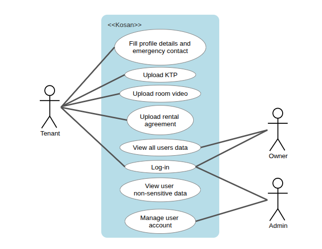

# KosanKu: Tenant Management System

A web app where a kos owner collects and stores tenant onboarding data: profile, emergency contact, KTP, rental agreement and room video. It replaces sending these over WhatsApp, where messages expire and files get lost.

Every item is stored three times, encrypted with AES, DES and RC4. Each copy carries an integrity check, so tampered data is rejected instead of returned. Only the tenant and their kos owner can open the profile, KTP and agreement. The admin can play a tenant's room video and nothing else.

**In scope:** collecting, storing and returning onboarding data; login; ownership-based access control; encryption with AES, DES and RC4; deletion after move-out.
**Out of scope:** rent payment, room booking, chat, digital signing, face recognition.

## How it works

1. A person pays for a room.
2. The admin creates their tenant account in that room and hands over a temporary password.
3. The tenant logs in, sets their own password, fills in their profile and uploads their documents.
4. The owner clicks a tenant in their list to see the profile, KTP, agreement and video. The admin clicks a tenant to see account details and the room video only.
5. After move-out, the tenant requests deletion. The owner approves it, or the admin when the tenant had already moved out when asking. Approval deletes every copy and destroys the tenant's key.

The system has exactly one owner, who can manage several kos. A tenant occupies one room.

## Actors

| Actor | Role under UU PDP | Can do |
|-------|-------------------|--------|
| Tenant | Data subject | Fill in profile and emergency contact, upload KTP / rental agreement / room video, download own documents, request deletion |
| Owner | Data controller | Manage kos and rooms, move tenants out, read documents of current tenants only, decide deletion requests |
| Admin | Processor | Create accounts (a tenant only together with an empty room), reset passwords, deactivate accounts, read the audit log, decide deletion requests that have no owner, play a tenant's room video. Cannot open profiles, KTPs or agreements |

<p align="center">
  
</p>

## Data classification

UU PDP (UU No. 27/2022) Art. 4 splits personal data into specific data (health, biometric, genetic, criminal records, child data, personal financial data) and general data (name, sex, nationality, religion, marital status, and data combined to identify a person). The elucidation of Art. 4(2)(b) names a facial image as biometric data, so the KTP photo and room video count as specific data.

## Security

| Cipher | Mode | Key | Integrity |
|--------|------|-----|-----------|
| AES | GCM | 256-bit, HKDF from the tenant key | GCM tag |
| DES | CBC | 56-bit effective, new key per file | HMAC-SHA256, encrypt-then-MAC |
| RC4 | Stream, first 3072 bytes dropped | Per-file key = HMAC-SHA256(tenant key, random nonce) | HMAC-SHA256 |

- Files are encrypted in 1 MiB chunks; each chunk's position and "last chunk" flag are authenticated, so reordering, cutting or appending is detected. A 200 MiB upload peaks at about 84 MiB of server memory.
- Each tenant has their own key (DEK), wrapped with `MASTER_KEY` from `.env`. The DEK is only unwrapped after the access check: for the tenant, their current owner, or the admin when the document is the room video.
- Deletion is crypto-shredding: files and rows are deleted and the DEK is destroyed, so any leftover copy is unreadable.
- Argon2id passwords, CSRF tokens on every form, a login limit of 5 failures per 5 minutes, security headers, and an audit log without personal data.

Details: [docs/implementation](docs/implementation/README.md) and the [report draft](docs/report.md).

## Running it

Requires Python 3.12.

```bash
python3.12 -m venv .venv && source .venv/bin/activate
pip install -r requirements.txt
./scripts/setup_tailwind.sh                       # downloads the Tailwind CLI into bin/

cp .env.example .env                              # then fill SECRET_KEY and MASTER_KEY, each with:
python -c "import os,base64;print(base64.b64encode(os.urandom(32)).decode())"

python scripts/seed.py                            # demo data, prints the logins
bin/tailwindcss -i app/static/input.css -o app/static/app.css
uvicorn app.main:app --reload                     # http://127.0.0.1:8000
```

Keep `.env` secret: anyone with it and the server can decrypt everything. Add `--watch` to the Tailwind command while editing templates.

To start over: `rm kosanku.db && rm -rf storage/blobs && python scripts/seed.py`.

### Demo accounts

Every seeded account's password is `kosanku-demo`.

| Email | Role |
|-------|------|
| `admin@kosanku.test` | Admin |
| `owner@kosanku.test` | Owner of Kos Melati (101, 102, 103) and Kos Mawar (A1, A2) |
| `tenant1@kosanku.test` | Tenant in Kos Melati 101 |
| `tenant2@kosanku.test` | Tenant in Kos Melati 102 |
| `tenant3@kosanku.test` | Tenant in Kos Mawar A1 |

Each tenant already has a profile, KTP, rental agreement and room video uploaded. The KTPs in [scripts/demo_files](scripts/demo_files) are generated fake specimens, not real people's cards. Rooms 103 and A2 are empty, for creating a new tenant.

## Tests and tools

```bash
pytest -q                     # all tests except the slow ones
pytest -q -m slow -s          # 200 MiB upload and the server memory test
python scripts/bench.py       # cipher speed, saved to bench.csv
python scripts/tamper.py --help   # corrupt a stored file for the tamper demo
```

If a ROS install on your machine breaks pytest (`ModuleNotFoundError: lark`), run with `PYTEST_DISABLE_PLUGIN_AUTOLOAD=1`.

## Project layout

```
app/
  auth/        login, password change, CSRF, roles
  crypto/      AES / DES / RC4 suites, chunked container, key wrapping, vault
  routes/      admin, owner, tenant pages
  services/    access control, uploads, downloads, deletion, audit log
  templates/   Jinja2 pages (Tailwind)
scripts/       seed, benchmark, tamper tool, demo files
tests/         crypto and web tests
docs/          implementation plan and report draft
```

## Team

| Member | Cipher | App |
|--------|--------|-----|
| Ata | AES-256-GCM | Skeleton, login, admin pages, audit log |
| Melvan | DES-CBC + HMAC | Kos and rooms, access control, owner pages, deletion approval |
| Ajil | RC4 + HMAC | Tenant profile, uploads, documents, deletion request |
| Naura | Chunked container, keys, vault | Streaming, crypto-shredding, benchmark and tamper tools |
